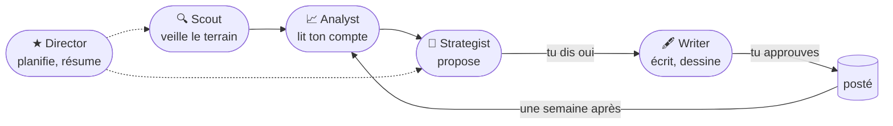

# Ripple_handoff

**Cinq agents qui font la communication d'un petit produit, sur la Meta Model API.**
Ils veillent, lisent tes chiffres, proposent, écrivent, puis relisent ce que ça a donné. Toi, tu dis oui ou non.

   

## Tester en deux minutes

```bash
export PATH=$HOME/.local/bin:$PATH
pnpm install
cp .env.example .env     # mets ta clé MODEL_API_KEY (dev.meta.ai)
pnpm dev:demo            # ouvre http://localhost:5190
```

Il faut Node 24 et pnpm 12 (`corepack enable --install-directory ~/.local/bin`). La démo charge le projet **Mairie360 (demo)** : de vrais posts Instagram et LinkedIn, et un vrai passage de l'équipe enregistré. Tout se parcourt **sans appel au modèle** ; les boutons *Propose*, *Yes, write it* et *Generate picture* en font de vrais et disent leur durée. Interface en anglais ou en français (sélecteur en bas à gauche, ou `?lang=fr` dans l'URL).

<p align="center"></p>

## Ce que ça fait



- **L'équipe travaille seule** : un passage par jour quand elle est *on duty* (recherche web, lecture des posts, propositions). Le premier écran dit ce qu'elle a fait pendant ton absence.
- **Tu décides** : oui, non ou « réécris » sur chaque proposition ; rien n'est écrit ni posté sans ton clic ; Stop à tout moment.
- **Chaque agent laisse sa trace** : ce qu'il a cherché, ouvert ou lu avant d'appeler le modèle, compté par le serveur.
- **La boucle se referme** : une pièce postée retrouve son vrai post, et une semaine après la carte compare promis et obtenu. Le Strategist lit ça avant de proposer la suite.

Côté Meta Model API : boucle d'outils de la Responses API pour le Scout (`search`, `open`), JSON strict validé par zod pour les autres agents, Muse Image pour les visuels, signal d'abandon sur chaque appel. Les chiffres sont calculés par le serveur, jamais par le modèle.

**Tout le détail est dans [docs/DOC.md](docs/DOC.md)** : les pages une par une, l'usage de l'API, la configuration complète, le développement.

## Ce que tu dois fournir

| Quoi | Pour quoi | Obligatoire |
|---|---|---|
| `MODEL_API_KEY` dans `.env` | clé de la Meta Model API, [dev.meta.ai](https://dev.meta.ai) | oui |
| Node 24, pnpm 12, git | l'orchestrateur et l'interface | oui |
| `INSTAGRAM_USER_ID`, `INSTAGRAM_ACCESS_TOKEN` | l'app lit ton compte Instagram elle-même ([comment](docs/DOC.md#instagram-lu-par-lapp)) | non : sinon tu colles tes posts |
| ffmpeg (H.264) | le diaporama local d'un post vidéo | pour la vidéo seulement |
| `FIGMA_TOKEN`, Muse Code, Chrome, GitHub CLI | le pipeline dev, masqué de l'interface ([détail](docs/DOC.md#pipeline-dev)) | non |

Chaque fonctionnalité qui demande une information de ta part est listée ici et détaillée dans la doc. Quand on en ajoute une, on l'ajoute aux deux.

## Développer

```bash
pnpm dev          # orchestrateur :8787, interface http://localhost:5173
pnpm test         # les deux paquets, ~12 s
pnpm typecheck    # doit passer avant tout commit
```

Monorepo pnpm : `packages/orchestrator` (Hono, SQLite, zod), `packages/console` (React, Vite), `packages/shared`. Détails, conventions de test et emplacement des fichiers dans [docs/DOC.md](docs/DOC.md#développer).
