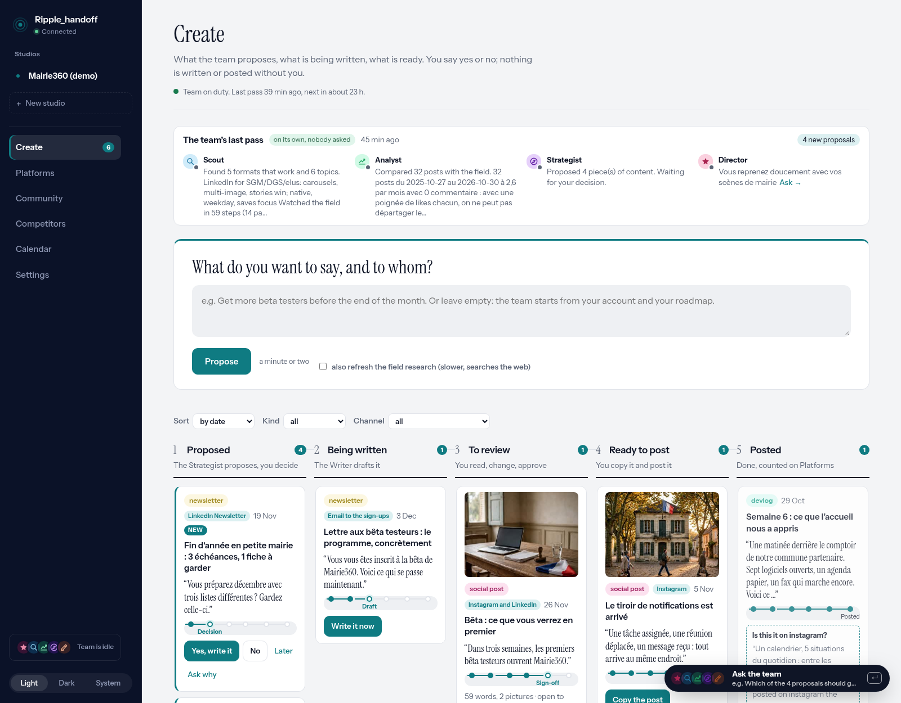
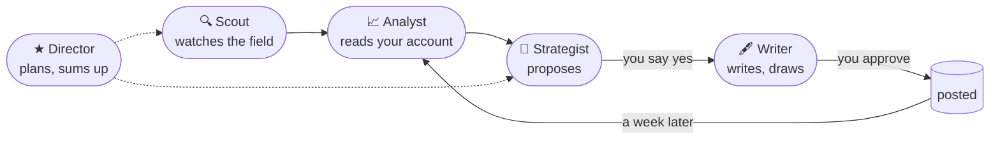

# Ripple_handoff

**Five agents that do the communication of a small product, on the Meta Model API.**
They watch the field, read your numbers, propose, write, then read what it got. You say yes or no.

   

Docs: [English](docs/DOC.md) · [Français](docs/DOC.fr.md)

> **Built for the Meta Global AI Developer Hackathon (Indie track), November 2026.**
> My university's final project asks us to produce content, run a market analysis and write a brand strategy for a real product, something none of us had been trained for. Ripple_handoff is my answer: instead of asking a model questions about it, I gave five agents on the Meta Model API the job itself, the way a small agency would do it, and kept for myself the only part that should stay human: deciding. The demo runs on Mairie360, a workspace for small French town halls that I build on the side: the dataset is extracted from my own project, its real Instagram and LinkedIn posts with their real numbers, and a real pass of the team on them.

## Try it in two minutes

```bash
export PATH=$HOME/.local/bin:$PATH
pnpm install
cp .env.example .env     # put your MODEL_API_KEY (dev.meta.ai)
pnpm dev:demo            # open http://localhost:5190
```

You need Node 24 and pnpm 12 (`corepack enable --install-directory ~/.local/bin`). The demo loads the **Mairie360 (demo)** project: real Instagram and LinkedIn posts, and a real pass of the team, recorded. Everything can be explored **without a single model call**; the *Propose*, *Yes, write it* and *Generate picture* buttons make real ones and say how long they take. The interface is in English or French (switch at the bottom left, or `?lang=fr` in the URL).

<p align="center"></p>

## What it does



- **The team works on its own**: one pass a day when it is *on duty* (web research, reading the posts, proposals). The first screen says what it did while you were away.
- **You decide**: yes, no or "rewrite" on every proposal; nothing is written or posted without your click; Stop at any time.
- **Every agent leaves a trace**: what it searched, opened or read before calling the model, counted by the server.
- **The loop closes**: a posted piece is matched with the real post, and a week later the card compares what was promised with what it got. The Strategist reads that before proposing the next one.

On the Meta Model API side: the Responses API tool loop for the Scout (`search`, `open`), strict JSON validated with zod for the other agents, Muse Image for the visuals, an abort signal on every call. Numbers are computed by the server, never by the model.

**Everything in detail is in [docs/DOC.md](docs/DOC.md)**: the pages one by one, how the API is used, the full configuration, development.

## What you have to provide

| What | For | Required |
|---|---|---|
| `MODEL_API_KEY` in `.env` | Meta Model API key, [dev.meta.ai](https://dev.meta.ai) | yes |
| Node 24, pnpm 12, git | the orchestrator and the interface | yes |
| `INSTAGRAM_USER_ID`, `INSTAGRAM_ACCESS_TOKEN` | the app reads your Instagram account itself ([how](docs/DOC.md#instagram-read-by-the-app)) | no: otherwise you paste your posts |
| ffmpeg (H.264) | the local slideshow of a video post | video only |
| `FIGMA_TOKEN`, Muse Code, Chrome, GitHub CLI | the dev pipeline, hidden from the interface ([detail](docs/DOC.md#dev-pipeline)) | no |

Every feature that needs something from you is listed here and detailed in the docs. When one is added, it goes in both.

## Develop

```bash
pnpm dev          # orchestrator on :8787, interface on http://localhost:5173
pnpm test         # both packages, ~12 s
pnpm typecheck    # must pass before any commit
```

pnpm monorepo: `packages/orchestrator` (Hono, SQLite, zod), `packages/console` (React, Vite), `packages/shared`. Details, test conventions and where files go in [docs/DOC.md](docs/DOC.md#develop).
